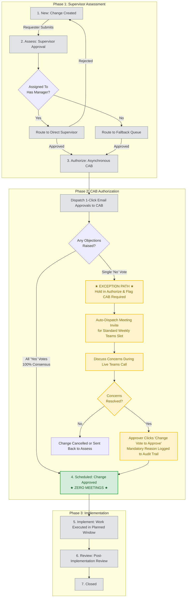

# Normal Change Management: End-to-End Process Brief
**Zero-Meeting Consensus & CAB by Exception**

---

## Executive Summary

This document outlines the redesigned **Normal Change Management Workflow**. The core objectives of this process are:
1. **Eliminate Team Approval Fatigue:** Route technical approvals directly to an engineer's supervisor rather than blasting the entire assignment group.
2. **"CAB by Exception" (Zero-Meeting Default):** Fast-track uncontested normal changes asynchronously via 1-click email approvals.
3. **Focused Live Review:** Hold live Microsoft Teams meetings *only* when a CAB member raises an objection ("No" vote).
4. **Transparent Audit Trail:** Log all in-meeting vote updates and justifications permanently for compliance.

---

## High-Level Process Flow

---

## The 4 Stages in Detail

### Stage 1: Submission & Planning (`New`)
* **Who:** Change Requester.
* **What Happens:** 
  * The requester inputs the change description, planned implementation window, backout plan, and risk questionnaire.
  * The requester clicks **Request Approval**.
  * The change transitions to **Assess**.

---

### Stage 2: Technical & Managerial Assessment (`Assess`)
* **Who:** Direct Supervisor (`assigned_to.manager`).
* **Why this is better:** 
  * In the past, the entire assignment group received approval requests, causing confusion and bystander apathy.
  * Now, ServiceNow checks the user profile of the technician assigned to do the work and generates **exactly one approval** for their direct supervisor.
* **Fallback Safety:** If a technician's manager field is blank, the change routes safely to a designated fallback lead queue so it is never lost.
* **Outcome:**
  * **Approved:** Automatically transitions to **Authorize**.
  * **Rejected:** Returns to **New** with supervisor feedback for revision.

---

### Stage 3: Asynchronous CAB Review (`Authorize`)
* **Who:** CAB Approval Group (`<CAB_APPROVAL_GROUP>`).
* **Timing:** Evaluated automatically for changes scheduled within the upcoming window (e.g. between last week and next week).
* **How Voting Works:**
  * Every CAB member receives an approval notification with change details and two 1-click buttons in their email: **Approve** and **Reject**.
  * Members vote directly from Outlook without logging into ServiceNow.

#### Path A: The Consensus Path (Zero Meetings)
* If **all members approve**, 100% quorum is reached asynchronously.
* The change **immediately advances to `Scheduled`**.
* **Result:** No meeting is held, no agenda is created, and no time is wasted reviewing routine, uncontested changes.

#### Path B: The Exception Path (Single "No" Vote)
* If **any single CAB member clicks Reject**:
  1. **Change Remains in `Authorize`:** It is not cancelled or kicked back to square one.
  2. **CAB Flagged:** `CAB Required` is set to `true`.
  3. **Automated Escalation Email:** An email is sent to all CAB members, the requester, and the technician with:
     * Details of the objection raised.
     * Meeting details and Teams link for the **regular weekly CAB time slot**.
     * Link to the Change Request and voting instructions.

---

### Stage 4: Live Teams Review & In-Meeting Vote Overturning
* **Where:** Standard Microsoft Teams Meeting (No complex CAB Workbench required).
* **Agenda:** Only contested changes that received a "No" vote are discussed.
* **In-Meeting Resolution:**
  1. The change owner explains the plan and addresses the specific concern raised by the dissenter.
  2. Once satisfied, the dissenter opens their approval record and clicks **Change Vote to Approve**.
  3. A prompt requires a brief **Justification Comment** (e.g., *"Rollback plan clarified during Teams CAB call"*).
  4. **Airtight Audit Trail:** ServiceNow stamps an immutable entry in the Change Request's permanent Work Notes capturing the approver's name, previous vote, new vote, timestamp, and justification.
  5. As soon as all votes are green, ServiceNow **automatically advances the change to `Scheduled`**.

---

## Key Benefits Matrix

| Area | Before | With New Process |
|---|---|---|
| **Assess Approval** | Entire assignment group flooded with requests | Exactly 1 request sent to direct supervisor |
| **CAB Meetings** | Weekly 60-minute meetings reviewing dozens of uncontested changes | Zero routine meetings; brief live syncs *only* for contested changes |
| **Voting Method** | Logging into ServiceNow or waiting for live call roll-call | 1-Click email voting or Service Portal card |
| **Handling Objections** | Clunky manual rescheduling or outright rejection | Automatic escalation to standard Teams slot; vote can be overturned with audit log |
| **Compliance & Audit** | Scattered email threads or chat notes | 100% of votes, comments, and in-meeting reversals stamped directly in the Change activity stream |
