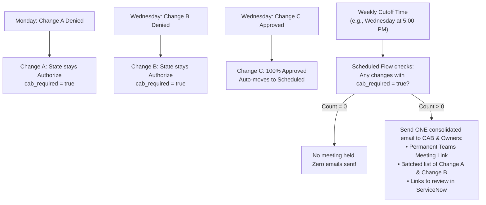

# ServiceNow Normal Change & Asynchronous CAB Setup Guide

This document is the master end-to-end implementation guide for configuring Normal Changes in ServiceNow (Washington DC and newer). It covers instance cleanup, supervisor-only technical approvals in the Assess phase, and zero-meeting asynchronous CAB approvals in the Authorize phase.

---

## Process Flow Overview

```
[New] 
  │  (Requester fills details & plans dates)
  ▼
[Assess] 
  │  ◄── PHASE 2: Supervisor Approval ONLY (Single Approver)
  │      (assignment_group.manager OR requested_by.manager)
  ▼
[Authorize] 
  │  ◄── PHASE 3 & 4: Asynchronous CAB Review (Zero Meetings)
  │      • Evaluates: Type = Normal & Planned Start Date between last week and next week
  │      • Dispatches 1-click email approvals to <CAB_APPROVAL_GROUP>
  │      • Quorum: ALL members must approve (ApprovesAll)
  │      • Supplemented by Weekly Async Review Digest
  ▼
[Scheduled] 
  │  (Implementation tasks generated & scheduled)
  ▼
[Implement] -> [Review] -> [Closed]
```

---

## Phase 0: Instance Cleanup (Decommissioning CAB Meetings)

Before implementing the new flows, clean up existing test meetings and stop automatic CAB meeting generation.

### 1. Deactivate CAB Definitions & Stop Meeting Generation
1. Navigate to **Change > Change Advisory Board > CAB Definitions**.
2. Open any active CAB Definition records you created.
3. Uncheck **Active**.
4. In the **Schedule** section, clear the schedule reference.
5. Click **Update**.
> [!NOTE]
> Deactivating the CAB Definition stops the scheduled engine (`CABDefinitionUtil`) from automatically creating future `cab_meeting` records or populating agenda items.

### 2. Purge Test CAB Meetings & Agenda Items
1. Navigate to **Change > Change Advisory Board > All CAB Meetings** (or type `cab_meeting.list` in the Filter Navigator).
2. Filter the list to locate your test meetings.
3. Select the checkboxes next to the records.
4. From the bottom action dropdown, select **Delete**.
   *(Deleting a `cab_meeting` automatically deletes all child `cab_agenda_item` records.)*

> [!TIP]
> **Scripted Cleanup via Background Script (`sys.scripts.do`):**
> ```javascript
> var grMeeting = new GlideRecord('cab_meeting');
> // Optional: grMeeting.addQuery('cab_definition.name', 'CONTAINS', 'Test');
> grMeeting.query();
> while (grMeeting.next()) {
>     grMeeting.deleteRecord(); // Cascades to cab_agenda_item
> }
> ```

---

## Phase 1: Core Change Model Setup

1. Navigate to **Change > Administration > Change Models**.
2. Open the **Normal** change model.
3. Verify the **Model State Transitions**:
   - `New` -> `Assess` (via UI Action "Request Approval")
   - `Assess` -> `Authorize` (upon Supervisor Approval)
   - `Authorize` -> `Scheduled` (upon CAB Approval)
   - `Scheduled` -> `Implement`
   - `Implement` -> `Review`
   - `Review` -> `Closed`
4. Ensure Risk Assessment conditions/questionnaires are active if required before moving to Assess.

---

## Phase 2: The Assess Phase (Supervisor Approval Configuration)

### Why Did the Entire Team Get Required Previously?
In out-of-the-box (OOB) ServiceNow, the Assess stage approval is often set to the **Assignment Group** (`current.assignment_group`). 
- When an approval is assigned to a group, ServiceNow creates a `sysapproval_approver` record for **every single member** of that team.
- If the rule was set to "All must approve" (`ApprovesAll`), every engineer on the team had to approve.
- Even with "Any can approve", the entire team was flooded with approval notifications.

### Current Implementation: Native User Hierarchy (`Assigned to -> Manager`)

Because your agency is already importing supervisor hierarchy into the standard OOB **Manager** field on User records (`sys_user.manager`), **you do not need to create any custom fields or alter form layouts.**

We can stay **100% Out-of-the-Box (OOB)**:
- The user doing the work is set in **Assigned to** (`assigned_to`).
- Flow Designer automatically dot-walks to **`Assigned to -> Manager`** and creates exactly **1 approval**.
- A simple **Safe Fallback Branch** handles the minority of users whose manager may be blank, routing them to a designated queue instead of breaking or auto-advancing.

---

### Step 1: Verify the Manager Field on User Records
1. In the Filter Navigator, type `sys_user.list`.
2. Add the **Manager** column to your list view if not already visible.
3. Verify that your active IT engineers/technicians have their direct supervisor populated in the **Manager** field.

---

### Step 2: Configure Flow Designer for Native Supervisor Approval & Fallback
1. Navigate to **Process Automation > Flow Designer**.
2. Open the flow: **Change - Normal - Assess** (or your unified Normal Change flow).
3. **Trigger**: 
   - Table: `Change Request [change_request]`
   - Condition: `State changes to Assess` AND `Type is Normal`.
4. **Step 1: Check If Manager Exists (If Condition)**:
   - Condition: `Trigger -> Change Request -> Assigned to -> Manager` **is not empty**
5. **Step 2 (Branch: Manager Exists - The Majority)**:
   - Action: **Ask for Approval**:
     - Record: `Trigger -> Change Request`
     - Rules:
       - Choose **User**.
       - Approver: `Trigger -> Change Request -> Assigned to -> Manager`.
       - Set condition: **Approve when: Anyone approves** (generates exactly 1 approval).
       - Set condition: **Reject when: Anyone rejects**.
   - **If Approved**: Update State -> `Authorize` (`14`).
   - **If Rejected**: Update State -> `New` (`-5`).
6. **Step 3 (Branch: Else - Manager Is Missing)**:
   - Action: **Ask for Approval**:
     - Choose **Group** or **User** -> `<FALLBACK_APPROVER_GROUP>` (e.g. Change Management or Service Desk Lead).
     - Set condition: **Approve when: Anyone approves**.
   - Action: **Log Work Note**:
     - Update Record Work note: *"Manager was not populated on user profile for [Assigned to]. Routed to fallback queue for assessment."*
   - **If Approved**: Update State -> `Authorize` (`14`).
   - **If Rejected**: Update State -> `New` (`-5`).

---

### Method 2: Change Approval Policy (Policy Engine for Assess)

If your instance uses ServiceNow Change Approval Policies (`sys_decision`):

1. Navigate to **Change > Administration > Change Approval Policies**.
2. Open **Normal Change Policy**.
3. Under the **Decisions** related list, you will see the policy decision rules evaluated by rank:
   - **Rank 1**: Evaluates in `Authorize` for High/Moderate risk (ignore for Assess).
   - **Rank 2**: Evaluates when `State is Assess` (labeled **Assess**).
4. Click into the **Rank 2** ("Assess") decision row.
5. In the **Answer** section, configure the approval rule:
   - **Option A (Assignment Group Manager Approval)**: Leave as-is if your organization requires the assignment group's manager to sign off.
   - **Option B (Direct Supervisor of Assigned Technician - Recommended)**:
     - **Name**: `Assigned to Manager Approval`
     - **Approval Action**: Select **`Add user approval`** *(Note: Do NOT choose `Approve`, as that acts as an auto-approve bypass and hides the Mandatory option).*
     - **Approver Source**: Select **`Change request`**.
     - **Mandatory**: Check the box (**`true`**).
     - **User Field**: Select **`Assigned to.Manager`** (`assigned_to.manager`).
       *(To select this, click the User Field picker, find `Assigned to`, click the `+` or `>` icon to expand/dot-walk into User fields, then select `Manager`).*
6. Click **Update** to save the decision rule.

---

## Phase 3: The Authorize Phase (Asynchronous CAB Policy)

Once the supervisor approves in the Assess phase, the change automatically transitions to `Authorize`.

### 1. Verify / Configure the CAB Decision (Rank 3)
1. In **Normal Change Policy**, look at **Rank 3** in the Decisions related list:
   - **Condition**: `Type is Normal` AND `Planned start date between last week and next week`.
   - **Answer**: Points to **`CAB Approval`**.
2. Click into **Rank 3**, and open the **CAB Approval** definition (click the preview icon next to the Approval definition field and select **Open Record**).
3. On the Approval Definition form:
   - **Group**: Ensure your official CAB group is selected (e.g. `<CAB_APPROVAL_GROUP>` / `Change Advisory Board`).
   - **Wait for**: Select **`Percentage of users`**.
   - **Percentage**: Enter **`100`**.
   *(Why: Setting 100% requires all CAB members to approve for asynchronous pass-through. If any single member votes Reject, it becomes impossible to reach 100%, immediately triggering the Phase 4 escalation path).*
4. Click **Update** on the Approval Definition, and **Update** on the Decision.

> [!WARNING]
> **Check for Duplicate Approvals with Rank 1**:
> In ServiceNow Change Approval Policies, all matching decision rules execute. If **Rank 1** also has `CAB Approval` as its answer, a High-risk change entering Authorize would match both Rank 1 and Rank 3, creating duplicate approval records.
> **Fix**: Deactivate Rank 1 (`Active = false`), or adjust Rank 1's condition so it does not conflict with Rank 3.

---

## Phase 4: Flow Designer Orchestration (Modifying OOB Authorize Flow)

Rather than building a flow from scratch, modify the existing out-of-the-box (OOB) Flow / Subflow **`Change - Normal - Authorize`**:

1. Navigate to **Process Automation > Flow Designer**.
2. Open the flow or subflow: **Change - Normal - Authorize**.
   *(Note: If ServiceNow indicates the flow is read-only, click the **three dots (`...`) in the top right > Copy Flow**, name it `Change - Normal - Authorize (Async CAB)`, and activate the copy).*

### What to Leave Unchanged:
* **Trigger / Subflow Inputs**: Leave as `State changes to Authorize` AND `Type is Normal`.
* **Action 1 (`Apply Change Approval Policy`)**: Leave as-is. It calls `Normal Change Policy` (which now uses your updated Rank 2 and Rank 3 rules).
* **Branch 1 (`If Approved`)**: Leave the state transition to `Scheduled` (`-2`) as-is. Optionally update the work note to: *"All members of CAB approved asynchronously. Moving to Scheduled."*

### What to Modify: The `If Rejected` Branch:
In your flow, the `If Rejected` branch currently contains only an existing **Send Email** action followed by **End Flow**.

Because there is no action forcing the state to `New` or `Assess`, the change already naturally remains in `Authorize`! We just need to flag the change, log the escalation work note, and customize the existing email:

1. **Add an "Update Record" action (Insert right above the existing `Send Email`)**:
   - Click the **`+`** icon directly above the existing `Send Email` action (or between `If Rejected` and `Send Email`).
   - Choose **Action > ServiceNow Core > Update Record**.
   - **Record**: Drag the **Change Request** data pill from the data pane.
   - **Fields to Update**:
     - **CAB required (`cab_required`)**: Set to **`true`** (Checked).
     - **Work notes**: Enter:
       > *"Dissenting vote received during asynchronous review. Change held in Authorize. Escalated to live Teams CAB meeting for review during our regular weekly meeting slot."*

2. **Modify the existing "Send Email" action (Immediate Ticket Owner Alert)**:
   - Click to open the existing **Send Email** step.
   - **Target Record**: Ensure the **Change Request** data pill is selected.
   - **To**: 
     - Drag data pill: `Change Request -> Assigned to`
     - Drag data pill: `Change Request -> Requested by`
     *(Note: Do not send the calendar invite to the entire CAB group here. To prevent calendar spam when multiple changes are denied throughout the week, the calendar invite is batched and sent once at the weekly cutoff - see Phase 4.1).*
   - **Subject**: `[NOTICE] Change Held in Authorize: ${number} - ${short_description}`
   - **Body**: Inform the technician that an objection was raised and their change has been queued for the upcoming weekly CAB meeting.

3. **Leave `End Flow` as-is**:
   - The flow safely terminates while the change stays in `Authorize` with `cab_required = true` awaiting the live Teams CAB discussion.

4. Click **Save** and **Activate** the flow.

---

## Phase 4.1: Weekly Escalation CAB Meeting & Batching (Without CAB Workbench)

This lightweight architecture implements a **"Zero-Meeting" default** with **weekly invitation batching** without needing the overhead of CAB Workbench, `cab_definition`, or `cab_meeting` records:
* **Pure Asynchronous Voting**: CAB members vote directly via 1-click email buttons, the Change form, or the Service Portal.
* **Zero-Meeting Default**: If all CAB members vote "Approve" asynchronously: **No live meeting takes place**.
* **Batched Notification on Cutoff**: If one or more changes are denied during the week, they accumulate in `Authorize`. At a defined weekly cutoff time (e.g., Wednesday at 5:00 PM), a scheduled flow checks for any denied changes and sends **one consolidated meeting notification with the Teams link and agenda** to the CAB group and change owners.



---

### Step 1: Real-Time Action on Deny (Flow Designer)

In your `Change - Normal - Authorize` flow (under the `If Rejected` branch):
1. **Update Record**:
   * Keep `State` as **`Authorize`** (`14`).
   * Set **`CAB required`** (`cab_required`) = **`true`**.
   * Add Work note: *"Dissenting vote received. Held in Authorize for live weekly Teams CAB review."*
2. **Send Email (Immediate Alert to Ticket Owner Only)**:
   * **To**: `Assigned to` and `Requested by`.
   * **Subject**: `[NOTICE] Change Held in Authorize: ${number} - ${short_description}`
   * **Body**: Informs the technician that an objection was raised, the change is held in Authorize, and it will be placed on the upcoming weekly live CAB agenda if not resolved prior to the cutoff.
   *(Note: Do NOT email the entire CAB group here; all denied changes will be batched together at the cutoff).*

---

### Step 2: Build the Weekly Scheduled Batch Flow (`Change - Weekly CAB Escalation Dispatcher`)

Instead of using CAB Workbench, create a simple scheduled flow that acts as the cutoff gatekeeper:

1. Navigate to **Process Automation > Flow Designer**.
2. Click **New > Flow**:
   * **Flow name**: `Change - Weekly CAB Escalation Dispatcher`
   * **Application**: `Global`
3. **Trigger**:
   * Select **Scheduled** -> **Repeats Weekly**.
   * **Day of week**: Select your cutoff day (e.g., **Wednesday** for a Thursday meeting).
   * **Time**: Select your cutoff time (e.g., **17:00:00** for 5:00 PM).
4. **Action 1: Look Up Denied Changes**:
   * Add Action > **ServiceNow Core > Look Up Records**.
   * **Table**: `Change Request [change_request]`
   * **Conditions**:
     * `State is Authorize`
     * AND `CAB required is true`
     * AND `Type is Normal`
5. **Flow Logic: Check if Any Denials Occurred**:
   * Add **Flow Logic > If**:
     * Condition: `1 - Look Up Records -> Count` **is greater than** `0`.
6. **Action 2 (Inside the If branch): Look Up CAB Group**:
   * Add Action > **ServiceNow Core > Look Up Record**.
   * **Table**: `Group [sys_user_group]`
   * **Conditions**: `Name is [Your CAB Group Name]` (e.g. *Change Advisory Board*).
7. **Action 3 (Inside the If branch): Send Consolidated Agenda Email**:
   * Add Action > **ServiceNow Core > Send Email**:
     * **Target Record**: Leave blank or reference first change.
     * **To**: Drag `2 - Look Up Record -> Group Record`.
     * **Subject**: `[ACTION REQUIRED] Live CAB Meeting Required This Week: Agenda & Teams Link`
     * **Body**: Click the **`fx` (Script)** button on the top-right of the **Body** field and paste the following script. It dynamically queries all denied changes and generates clean clickable links, ticket titles, assignees, and risk levels:
       ```javascript
       var instanceUrl = gs.getProperty('glide.servlet.uri');
       var html = "<p>Hello CAB Team,</p>";
       html += "<p>The following Normal Changes received dissenting votes during asynchronous review this week and are scheduled for live discussion:</p>";
       html += "<ul>";

       var grChg = new GlideRecord('change_request');
       grChg.addQuery('state', 14); // Authorize
       grChg.addQuery('cab_required', true);
       grChg.addQuery('type', 'normal');
       grChg.orderBy('number');
       grChg.query();

       while (grChg.next()) {
           var ticketUrl = instanceUrl + "nav_to.do?uri=change_request.do?sys_id=" + grChg.getUniqueValue();
           html += "<li>";
           html += "<a href='" + ticketUrl + "'><b>" + grChg.getValue('number') + "</b></a>: ";
           html += grChg.getValue('short_description');
           html += " (Assigned To: " + grChg.assigned_to.getDisplayValue() + ", Risk: " + grChg.risk.getDisplayValue() + ")";
           html += " - <a href='" + ticketUrl + "'>[Open Ticket]</a>";
           html += "</li>";
       }

       html += "</ul>";
       html += "<p><b>Weekly Live Meeting Details</b></p>";
       html += "<ul>";
       html += "<li>When: Every Thursday at 2:00 PM EST</li>";
       html += "<li>Teams Meeting Link: <a href='<YOUR_TEAMS_MEETING_URL>'>Click here to join Microsoft Teams Meeting</a></li>";
       html += "<li>All Queued Changes: <a href='" + instanceUrl + "change_request_list.do?sysparm_query=state%3D14%5Ecab_required%3Dtrue'>View Full List in ServiceNow</a></li>";
       html += "</ul>";
       html += "<p>Implementers: Please attend the Teams call to discuss concerns and address objections with the board.</p>";

       return html;
       ```
8. **Save and Activate** the flow.

---

### Step 3: During the Live Teams Call (Review & Vote Overturning)

Because you are not using CAB Workbench:
1. Attendees join your standard recurring **Microsoft Teams** meeting link.
2. The CAB Lead or technician clicks the link in the notification email (or opens the filtered list: `State is Authorize` AND `CAB required is true`).
3. The technician shares their screen, presents the change, and addresses the objection.
4. Once concerns are resolved, the member who voted "No" (or the CAB Lead) clicks the **"Change Vote to Approve"** button directly on the ticket's approval record (configured in **Phase 4.2** below).
5. Once all votes are changed to Approved, the change automatically moves to **`Scheduled`**.

## Phase 4.2: Self-Service Vote Overturning & Full Audit Trail (Anytime in Authorize)

Out-of-the-box, once an approver marks a record as `rejected`, ServiceNow locks the record and hides the approve buttons. 

To allow CAB members to overturn a "No" vote **at any time** (whether asynchronously from their desk as soon as concerns are resolved on Tuesday, or during the live Teams meeting on Thursday), configure the following:

> [!TIP]
> **Avoid the Live Meeting Completely**:
> If an implementer answers an objection in chat or updates their plan on Tuesday, the CAB member can overturn their vote immediately. If all dissenting votes are overturned to Approved before the Wednesday 5:00 PM cutoff, the change automatically moves to `Scheduled`, and **no live meeting takes place!**

---

### 1. Create UI Action: "Change Vote to Approve"
Allows the original approver (or the Change Manager/Admin) to overturn a rejection at any time while the change is in `Authorize`.

1. Navigate to **System Definition > UI Actions**.
2. Click **New** and configure:
   * **Name**: `Change Vote to Approve`
   * **Table**: `Approval [sysapproval_approver]`
   * **Action name**: `overturn_cab_vote_approve`
   * **Form button**: Checked
   * **List choice**: Checked *(allows 1-click overturning directly from the Approvers related list on the Change Request)*
   * **List context menu**: Checked
   * **Client**: Checked
   * **Onclick**: `promptForJustification()`
   * **Condition**:
     ```javascript
     current.state == 'rejected' && (current.approver == gs.getUserID() || gs.hasRole('change_manager') || gs.hasRole('admin')) && current.sysapproval.state == 14 /* Authorize */
     ```
   * **Script**:
     ```javascript
     function promptForJustification() {
         var reason = prompt("Please enter the justification for overturning this vote (e.g., concerns addressed offline or in CAB):");
         if (!reason || reason.trim() === "") {
             alert("A justification comment is mandatory to change a vote.");
             return false;
         }
         g_form.setValue('comments', "VOTE OVERTURNED TO APPROVED: " + reason);
         gsftSubmit(null, g_form.getFormElement(), 'overturn_cab_vote_approve');
     }

     // Server-side execution
     if (typeof window == 'undefined') {
         current.state = 'approved';
         current.update();
         action.setRedirectURL(current);
     }
     ```

---

### 1.1 (Optional) Create UI Action: "Change Vote to Reject"
Allows a member who voted "Approve" prematurely to switch their vote to "Reject" before the cutoff if they discover a late conflict:

1. Navigate to **System Definition > UI Actions**.
2. Click **New** and configure:
   * **Name**: `Change Vote to Reject`
   * **Table**: `Approval [sysapproval_approver]`
   * **Action name**: `overturn_cab_vote_reject`
   * **Form button**: Checked
   * **List choice**: Checked
   * **List context menu**: Checked
   * **Client**: Checked
   * **Onclick**: `promptForRejectJustification()`
   * **Condition**:
     ```javascript
     current.state == 'approved' && (current.approver == gs.getUserID() || gs.hasRole('change_manager') || gs.hasRole('admin')) && current.sysapproval.state == 14 /* Authorize */
     ```
   * **Script**:
     ```javascript
     function promptForRejectJustification() {
         var reason = prompt("Please state the concern/objection for switching your vote to Reject:");
         if (!reason || reason.trim() === "") {
             alert("A reason is mandatory to reject a change.");
             return false;
         }
         g_form.setValue('comments', "VOTE SWITCHED TO REJECT: " + reason);
         gsftSubmit(null, g_form.getFormElement(), 'overturn_cab_vote_reject');
     }

     // Server-side execution
     if (typeof window == 'undefined') {
         current.state = 'rejected';
         current.update();
         action.setRedirectURL(current);
     }
     ```

### 2. Create Business Rule: Audit Logger on Parent Change Request
Ensures that whenever an approval changes after being previously decided, an immutable audit entry is stamped in the Change Request's permanent Work Notes / Activity Log.

1. Navigate to **System Definition > Business Rules**.
2. Click **New** and configure:
   - **Name**: `Audit CAB Vote Change to Change Request`
   - **Table**: `Approval [sysapproval_approver]`
   - **Active**: Checked
   - **Advanced**: Checked
   - **When**: `after` | **Update**: Checked
   - **Filter Conditions**:
     - `State` `changes`
     - AND `State (previous)` `is not` `Requested`
     - AND `Approval for` `is not empty`
3. In the **Advanced** tab, add the script:
   ```javascript
   (function executeRule(current, previous /*null when async*/) {
       var chg = new GlideRecord('change_request');
       if (chg.get(current.sysapproval)) {
           var approverName = current.approver.getDisplayValue() || "Unknown Approver";
           var prevVote = previous.state.getDisplayValue();
           var newVote = current.state.getDisplayValue();
           var notes = current.comments.getJournalEntry(1) || "No comment provided.";

           var auditEntry = "=== CAB VOTE CHANGE AUDIT ===\n" +
               "Approver: " + approverName + "\n" +
               "Previous Vote: " + prevVote + "\n" +
               "New Vote: " + newVote + "\n" +
               "Updated By: " + gs.getUserDisplayName() + " (" + gs.getUserName() + ")\n" +
               "Details / Justification:\n" + notes + "\n" +
               "=============================";

           chg.work_notes = auditEntry;
           chg.update();
       }
   })(current, previous);
   ```

---

### 3. Flow Designer: Resume Flow Upon Overturned Vote
In your Authorize Flow (`Change - Normal - Authorize`):

1. Under the **If Rejected** branch (after updating `cab_required = true` and sending the escalation email):
2. Add Action: **Wait for Condition**:
   - **Table**: `Change Request [change_request]`
   - **Record**: `Trigger -> Change Request`
   - **Condition**: `Approval` `is` `Approved`
3. Immediately following the Wait for Condition step:
   - **Update Record (`change_request`)**:
     - `State` -> `Scheduled` (Value `-2`)
     - `Work Notes` = *"All CAB approvals obtained (including in-meeting vote updates). Advancing to Scheduled."*

---

## Phase 5: Asynchronous 1-Click Email Voting Setup

Approval records (`sysapproval_approver`) are automatically created for each member of `<CAB_APPROVAL_GROUP>`. Members vote directly from their inbox without logging in or opening a meeting.

### 1. Verify Email Notifications
1. Navigate to **System Notification > Email > Notifications**.
2. Open **Change Request - Approval** (Table: `sysapproval_approver`).
3. Ensure it triggers when `State changes to Requested`.
4. Ensure the body includes the 1-click mailto links:
   ```html
   <p>Change Request <strong>${sysapproval.number}</strong> is ready for CAB authorization.</p>
   
   <p><strong>Short Description:</strong> ${sysapproval.short_description}</p>
   <p><strong>Planned Window:</strong> ${sysapproval.start_date} to ${sysapproval.end_date}</p>
   <p><strong>Risk / Impact:</strong> ${sysapproval.risk} / ${sysapproval.impact}</p>
   
   <p>Cast your vote directly:</p>
   <p>
     <strong>${mailto:mailto.approval}</strong> &nbsp;|&nbsp; 
     <strong>${mailto:mailto.rejection}</strong>
   </p>
   ```

### 2. Verify Inbound Action
1. Navigate to **System Policy > Email > Inbound Actions**.
2. Verify **Update Approval Record** is **Active**.
3. When a user clicks the mailto link and sends the email, this action matches the watermark and marks that approver's record as `Approved` or `Rejected`.

---

## Phase 6: Scheduled Weekly CAB Review Digest (HTML Calendar Grid & Full Operations Agenda)

To give the entire CAB and IT leadership full visibility across the organization's change velocity, this weekly digest runs prior to the weekly meeting slot (e.g., Wednesday at 5:00 PM or Thursday morning). 

It automatically aggregates **Normal**, **Standard**, and **Emergency** changes scheduled in the upcoming **2-week future window** (**starting from today through the next 14 days**), rendering:
1. **HTML Calendar Grid Table**: A clean 7-column calendar grid (Mon - Sun) built with standard HTML tables, rows, cells, and line breaks, displaying each day in the 2-week window with its scheduled changes and clickable links.
2. **Itemized Record Details Table**: A detailed table containing every change, its planned window, assignee, risk, state, and a **direct clickable hyperlink** to open each ticket.

---

### Step 1: Create the Flow in Flow Designer

1. Navigate to **Process Automation > Flow Designer**.
2. Click **New > Flow**:
   * **Flow name**: `CAB - Weekly Change Operations Digest`
   * **Application**: `Global`
3. **Trigger**:
   * Select **Scheduled** -> **Repeats Weekly**.
   * **Day of week**: Select your pre-meeting day (e.g., **Wednesday** for a Thursday meeting, or Thursday morning).
   * **Time**: (e.g., **17:00:00** for 5:00 PM).
4. **Action 1: Look Up CAB Group**:
   * Add Action > **ServiceNow Core > Look Up Record**.
   * **Table**: `Group [sys_user_group]`
   * **Conditions**: `Name is [Your CAB Group Name]` (e.g., *Change Advisory Board*).
5. **Action 2: Send Email**:
   * Add Action > **ServiceNow Core > Send Email**.
   * **Target Record**: Leave blank.
   * **To**: Drag `1 - Look Up Record -> Group Record`.
   * **Subject**: `[CAB DIGEST] Upcoming 14-Day Change Implementation Schedule: Normal, Standard & Emergency`
   * **Body**: Click the **`fx` (Script)** button on the top-right of the **Body** field and paste the script below.
6. Click **Save** and **Activate**.

---

### Step 2: The Digest Generator Script (Body `fx` Script)

Paste this complete script into the **Body `fx`** editor. It executes the query for all upcoming changes across all three types over the next 14 days, builds the HTML 7-column calendar grid and the itemized record table, and generates direct ticket links:

```javascript
var instanceUrl = gs.getProperty('glide.servlet.uri');

// 1. Query Normal, Standard, Emergency changes in the upcoming 2-week window (today through +14 days)
var gr = new GlideRecord('change_request');
gr.addQuery('type', 'IN', 'normal,standard,emergency');
gr.addQuery('start_date', '>=', gs.beginningOfToday());
gr.addQuery('start_date', '<=', gs.daysAgoEnd(-14));
gr.addQuery('state', 'NOT IN', '3,4,8'); // Exclude Closed (3), Canceled (4/8)
gr.orderBy('start_date');
gr.query();

var totalCount = 0;
var normalCount = 0;
var standardCount = 0;
var emergCount = 0;
var changesByDate = {};
var allChanges = [];

while (gr.next()) {
    totalCount++;
    var type = gr.getValue('type') || 'normal';
    if (type == 'normal') normalCount++;
    else if (type == 'standard') standardCount++;
    else if (type == 'emergency') emergCount++;

    var startDateRaw = gr.getValue('start_date') || '';
    var dateKey = startDateRaw ? startDateRaw.split(' ')[0] : 'Unscheduled';
    var timeKey = startDateRaw ? startDateRaw.split(' ')[1].substring(0, 5) : '';

    var chgObj = {
        sysId: gr.getUniqueValue(),
        number: gr.getValue('number'),
        type: type,
        shortDesc: gr.getValue('short_description') || 'No description',
        assignedTo: gr.assigned_to.getDisplayValue() || 'Unassigned',
        risk: gr.risk.getDisplayValue() || 'Moderate',
        state: gr.state.getDisplayValue() || '',
        startDate: startDateRaw,
        endDate: gr.getValue('end_date') || '',
        dateKey: dateKey,
        timeKey: timeKey
    };

    if (!changesByDate[dateKey]) {
        changesByDate[dateKey] = [];
    }
    changesByDate[dateKey].push(chgObj);
    allChanges.push(chgObj);
}

// 2. Build Clean HTML Output (Standard semantic HTML, no color codes or graphical boxes)
var html = "<p><b>Weekly Change Operations & CAB Digest</b></p>";
html += "<p>Upcoming 14-Day Implementation Schedule (Today to Next 2 Weeks)</p>";
html += "<p><b>Summary:</b> Normal: " + normalCount + " | Standard: " + standardCount + " | Emergency: " + emergCount + " | Total: " + totalCount + " Upcoming Changes</p>";
html += "<hr/>";

// Section 1: Visual Calendar Table (7-Day Grid)
html += "<p><b>2-Week Implementation Calendar Grid</b></p>";

var gdtToday = new GlideDateTime();
var todayDateStr = gdtToday.getDate().getValue(); // "YYYY-MM-DD"
var dayOfWeek = gdtToday.getDayOfWeekLocalTime(); // 1 = Mon, 7 = Sun

// Start calendar on Monday of the current week
var gdtCal = new GlideDateTime(gdtToday);
gdtCal.addDaysLocalTime(-(dayOfWeek - 1));

// Calculate number of weeks needed to cover from this Monday through 14 days from today
var daysCovered = (dayOfWeek - 1) + 14;
var totalWeeks = Math.ceil(daysCovered / 7);

html += "<table border='1' cellpadding='6' cellspacing='0' style='width: 100%; border-collapse: collapse; text-align: left;'>";
html += "<thead>";
html += "<tr>";
html += "<th align='center' style='width: 14%;'>Mon</th>";
html += "<th align='center' style='width: 14%;'>Tue</th>";
html += "<th align='center' style='width: 14%;'>Wed</th>";
html += "<th align='center' style='width: 14%;'>Thu</th>";
html += "<th align='center' style='width: 14%;'>Fri</th>";
html += "<th align='center' style='width: 14%;'>Sat</th>";
html += "<th align='center' style='width: 14%;'>Sun</th>";
html += "</tr>";
html += "</thead>";
html += "<tbody>";

for (var w = 0; w < totalWeeks; w++) {
    html += "<tr>";
    for (var d = 0; d < 7; d++) {
        var dStr = gdtCal.getDate().getValue();
        var monthDay = dStr.substring(5, 7) + "/" + dStr.substring(8, 10);
        var isToday = (dStr == todayDateStr);

        html += "<td valign='top' style='width: 14%; height: 80px; vertical-align: top;'>";
        html += "<b>" + monthDay + "</b>" + (isToday ? " <small>(Today)</small>" : "");

        if (changesByDate[dStr] && changesByDate[dStr].length > 0) {
            var dayList = changesByDate[dStr];
            for (var k = 0; k < dayList.length; k++) {
                var c = dayList[k];
                var cLink = instanceUrl + "nav_to.do?uri=change_request.do?sys_id=" + c.sysId;
                var shortSnippet = c.shortDesc.length > 25 ? (c.shortDesc.substring(0, 22) + "...") : c.shortDesc;
                html += "<br/><a href='" + cLink + "'><b>" + c.number + "</b></a> [" + c.type.toUpperCase() + "]";
                html += "<br/><small>" + (c.timeKey ? c.timeKey + " " : "") + shortSnippet + "</small>";
            }
        }
        html += "</td>";

        gdtCal.addDaysLocalTime(1);
    }
    html += "</tr>";
}

html += "</tbody>";
html += "</table>";

// Section 2: Comprehensive Details Table with Direct Links
html += "<hr/>";
html += "<p><b>Itemized Change Record Details</b></p>";

html += "<table border='1' cellpadding='6' cellspacing='0' style='width: 100%; border-collapse: collapse;'>";
html += "<thead>";
html += "<tr>";
html += "<th align='left'>Ticket</th>";
html += "<th align='left'>Type</th>";
html += "<th align='left'>Short Description</th>";
html += "<th align='left'>Planned Window</th>";
html += "<th align='left'>Assigned To</th>";
html += "<th align='left'>Risk / State</th>";
html += "</tr>";
html += "</thead>";
html += "<tbody>";

if (allChanges.length == 0) {
    html += "<tr><td colspan='6' align='center'><em>No upcoming changes scheduled in the next 14 days.</em></td></tr>";
} else {
    for (var j = 0; j < allChanges.length; j++) {
        var item = allChanges[j];
        var tLink = instanceUrl + "nav_to.do?uri=change_request.do?sys_id=" + item.sysId;

        html += "<tr>";
        html += "<td><a href='" + tLink + "'><b>" + item.number + "</b></a></td>";
        html += "<td>" + item.type + "</td>";
        html += "<td>" + item.shortDesc + "</td>";
        html += "<td>" + item.startDate + "<br/>to " + item.endDate + "</td>";
        html += "<td>" + item.assignedTo + "</td>";
        html += "<td>" + item.risk + "<br/>" + item.state + "</td>";
        html += "</tr>";
    }
}

html += "</tbody>";
html += "</table>";

html += "<hr/>";
html += "<p><em>Automated Change Management Digest dispatched weekly prior to CAB. Direct questions or concerns to the Change Advisory Board lead.</em></p>";

return html;
```

## Phase 7: Testing & Verification Checklist

- [ ] **Cleanup Verification**: Open `cab_meeting.list`. Verify all test meetings are gone and no new meetings are generated.
- [ ] **Assess Phase Test**:
  - Open `sys_user.list` and verify that the test user has a **Manager** set on their profile.
  - Create a Normal Change in `New` state with `assigned_to` set to that test user.
  - Request approval to transition into `Assess`.
  - Check the `Approvers` related list on the Change Request.
  - **Verify**: Exactly ONE approval is generated, assigned specifically to that user's Manager (`assigned_to.manager`). The assignment group does NOT receive approval requests.
  - Approve the record. Confirm state automatically transitions to `Authorize`.
- [ ] **Assess Fallback Test (Blank Manager)**:
  - Create a test user with a blank **Manager** field.
  - Submit a Normal Change with `assigned_to` set to that user.
  - Move to `Assess`.
  - **Verify**: Flow catches the missing manager and routes approval to `<FALLBACK_APPROVER_GROUP>` with a work note flag.
- [ ] **Authorize Phase Test (In-Window)**:
  - Ensure `Planned start date` is between last week and next week.
  - Check the `Approvers` related list.
  - **Verify**: Approvals are generated for all members of `<CAB_APPROVAL_GROUP>`.
  - Have all members approve via email or portal. Confirm state transitions to `Scheduled`.
- [ ] **Authorize Phase Test (Rejection)**:
  - If any single member rejects, confirm state transitions back to `Assess` or `New`.

---

## Phase 8: Future Roadmap & Enhancements (Backlog)

1. **Hierarchy Gap Remediation**: Identify and populate any missing managers in your source of truth / user import feed to reduce fallback approvals.
2. **Dynamic CAB Routing (Advanced)**: Route to different CAB groups based on the Configuration Item (CI) or Change category (e.g. Infrastructure CAB vs Application CAB) if volume grows.

